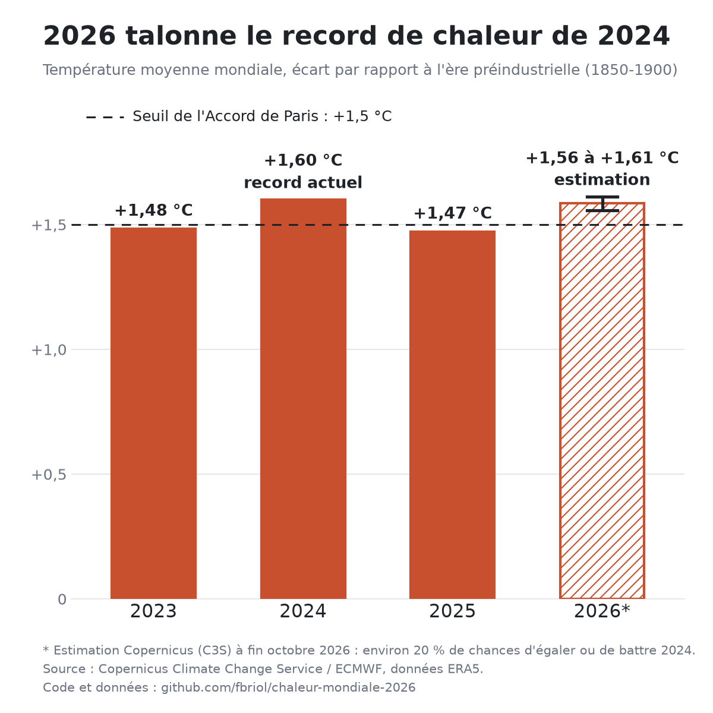

# 2026 talonne le record de chaleur de 2024



Ce dépôt contient le script qui produit cette figure, pour que chacun puisse
la vérifier et la refaire.

## D'où viennent les données

Le script ne contient aucune température saisie à la main. Il télécharge le fichier
publié par le **Copernicus Climate Change Service** (C3S, opéré par l'ECMWF
pour la Commission européenne) avec son bulletin d'octobre 2026 :

- Bulletin : <https://climate.copernicus.eu/copernicus-warmest-october-record-2026-virtually-certain-exceed-15degc>
- Données (CSV) : <https://climate.copernicus.eu/sites/default/files/2026-11/C3S_Bulletin_PR_202610_timeseries_annual_global_surface_temperature_anomalies_ref1850-1900_prediction_DATA.csv>

Les températures sont des moyennes mondiales annuelles de l'air en surface
(réanalyse ERA5), exprimées en écart à la période préindustrielle 1850-1900.
La valeur 2026 est une estimation de C3S établie à fin octobre : l'année
n'est pas terminée.

## Ce que dit Copernicus

- 2024 reste l'année la plus chaude mesurée : +1,60 °C.
- 2026 devrait finir entre +1,56 et +1,61 °C, très probablement au deuxième
  rang, avec environ 20 % de chances d'égaler ou de dépasser 2024.
- Ce serait la deuxième année civile au-dessus de +1,5 °C.

## Refaire la figure

```bash
pip install -r requirements.txt
python plot_temperature.py
```

Une copie du fichier téléchargé est conservée dans `data/`. La figure est
aussi régénérée automatiquement par GitHub Actions à chaque modification.

## Licence

Code : MIT. Données : © Copernicus Climate Change Service / ECMWF.
